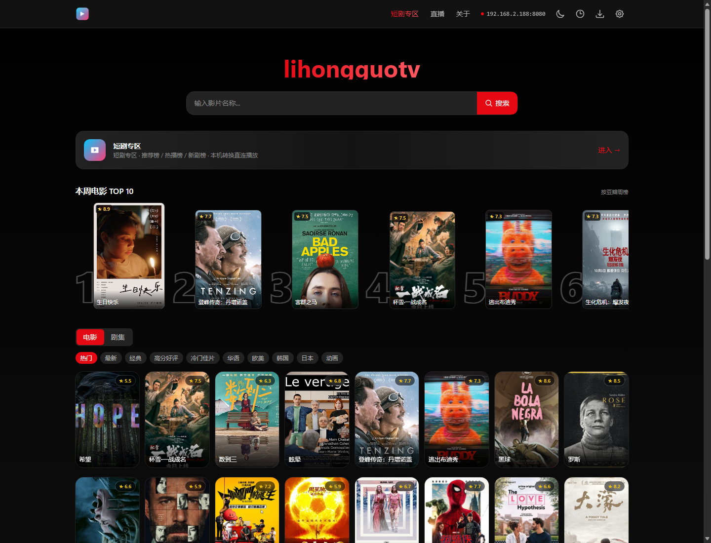
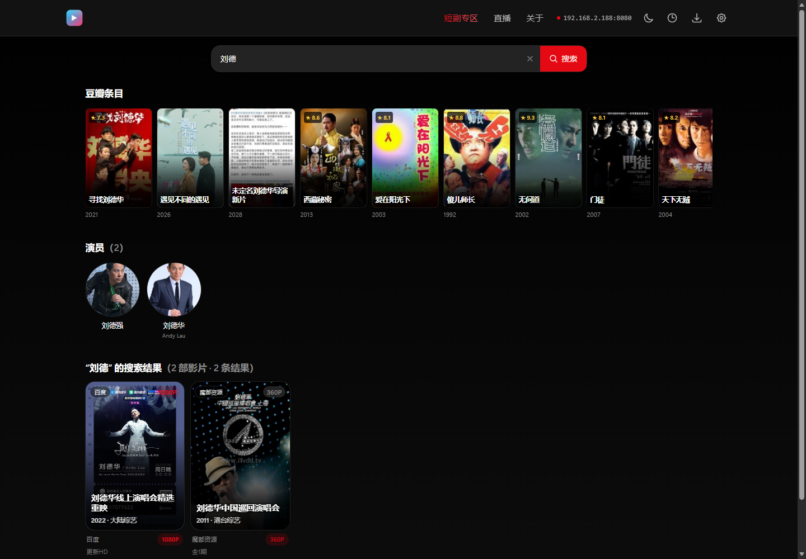
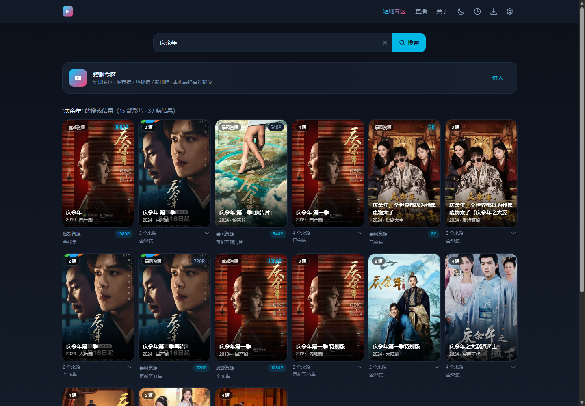
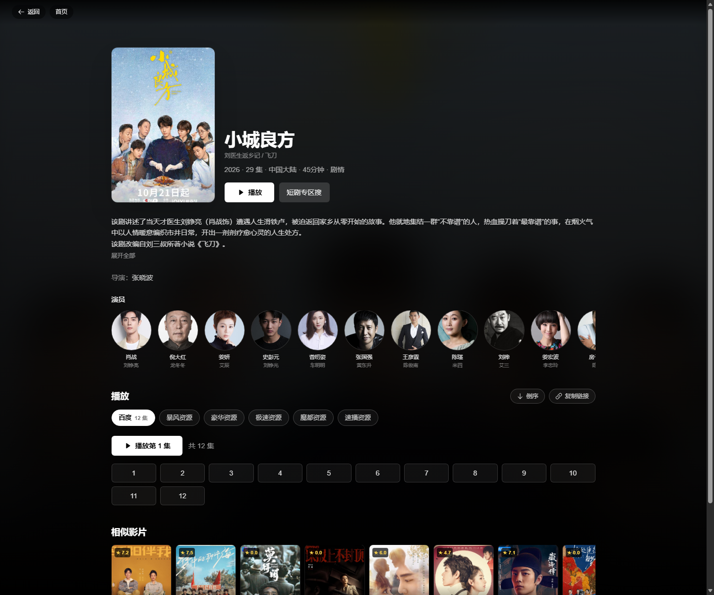
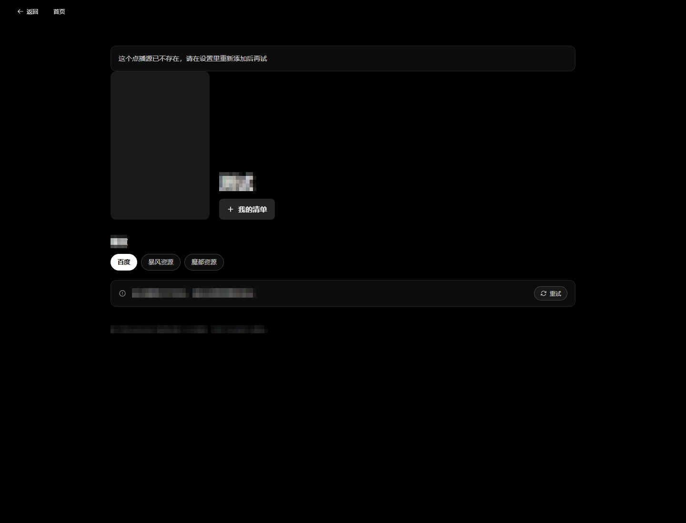
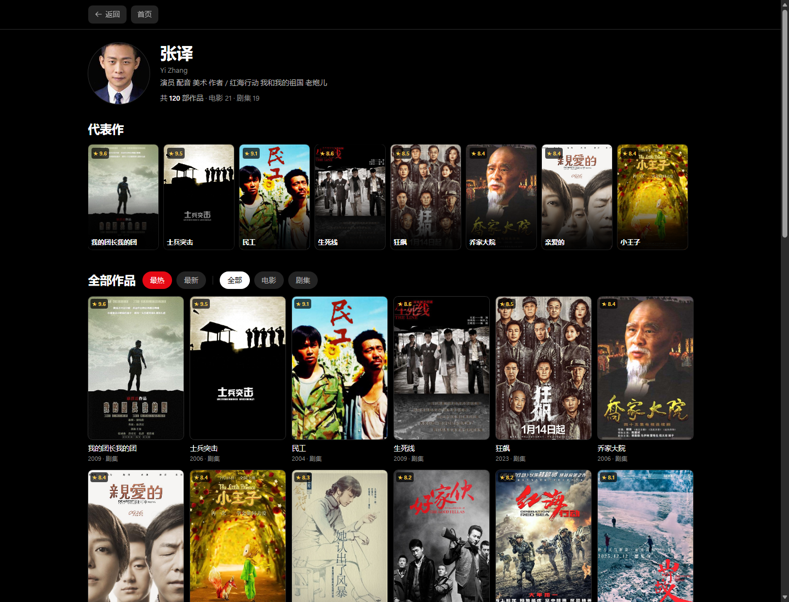

# MFlixTV

把开源的影视聚合站点 [LibreTV](https://github.com/LibreSpark/LibreTV) 做成**能在 Windows 上双击安装、在 macOS 上解压即用的桌面应用**：Netflix 风格的首页与资料页、**影片和演员一起搜的检索**、换集换源不黑屏的播放器，外加一个**短剧专区**（体裁分类 / 观看历史 / 换源续播）。

<table>
  <tr>
    <td align="center"><br><sub>首页：头图 + 继续观看 + TOP 10</sub></td>
    <td align="center"><br><sub>搜人名片段 → 命中演员</sub></td>
  </tr>
</table>

> **定位**：个人自建的播放器外壳，只负责「界面 + 播放 + 本机转发」。**不提供、不索引、不托管、不分发任何影视内容，不含任何片源、账号或订阅凭据**；所有可播放内容来自使用者自行配置的第三方接口。请勿用于商业用途或对外分发。
>
> 本项目是 [LibreTV](https://github.com/LibreSpark/LibreTV) 的桌面封装与二次开发分支，遵循上游 **AGPL-3.0** 许可；源码完整公开（AGPL 第 13 条）。合规边界与你的责任见 [docs/合规与免责.md](docs/合规与免责.md)。

---

## 目录

- [功能](#功能)
- [截图](#截图)
- [快速开始](#快速开始)
- [短剧专区](#短剧专区)
- [安卓版（APK）](#安卓版apk)
- [点播源与可用性排序](#点播源与可用性排序)
- [更新机制](#更新机制)
- [从源码运行](#从源码运行)
- [打包](#打包)
- [项目结构](#项目结构)
- [已知限制](#已知限制)
- [许可与致谢](#许可与致谢)

---

## 功能

**检索：影片和演员一起搜**

- 一条搜索框同时打三类数据：自己的点播源（并行流式返回）、豆瓣条目、豆瓣演员
- 搜人名也能出结果：输入姓氏片段 → 命中对应演员，点进演员页看全部作品（联想命中不了时，会退化成「按人名搜影片 → 演职员表模糊匹配」，所以给名字片段也找得到）
- 跨源同名影片自动合并成一张卡，展开可直接比较各来源的画质与速度

**资料页：所有片名、人名都点得动**

- 采集源资料页 `/detail/<源>/<片>`：海报、年份地区类型、简介、导演主演、播放源、剧集一页看完——原来的「播放前详情弹窗」已经并进这一页
- 豆瓣资料页 `/title/<id>`：评分 / 简介 / 演员（可点进演员页）/ **相似影片** / 页内直接换源选集
- 导演、主演渲染成名字胶囊，点一下就用这个名字再搜；换源面板有「看资料」，观看历史每条也有「资料」，不用先进播放器

**播放：观影体验优先**

- 播放内核 ArtPlayer + hls.js：前向缓冲 60s（开缓存 120s）、首片预取、按播放器尺寸选档、分片重试 8 次
- 换集 / 换源**不黑屏**：切换瞬间把上一帧抓成遮罩，新分片进 buffer 才淡出
- 换源面板标出**最快**源（有集数且详情接口最快），当前源本来就最快时直接说「不用换」
- 手势：双击左 / 右 ±10 秒、长按 2 倍速；快捷键 空格 / ←→ / ↑↓ / F / Alt+←→
- 广告分片过滤、跳过片头片尾、倍速记忆、断点续播、自动连播

**首页：Netflix 那套结构**

- 头图 billboard（本周推荐 + 播放 / 更多信息 + 右侧候选封面）
- 继续观看（红色进度条 + 「第 N 集 · 剩余约 X 分钟」，点一下按上次位置续播）
- 本周 TOP 10（大数字排名）、分类推荐网格、相似影片行

**短剧专区（本项目新增）**

- 两层导航：真人剧 / 漫剧 / AI短剧 → 各自的推荐 / 热播 / 新剧
- 观看历史按「剧 + 集」记进度；**换源续播**只往前挪 10 秒（不同源码率不同，往后挪必然漏剧情）
- 收藏 / 已看标记 / 连播倒计时 / 倍速记忆；服务端历史同步（换浏览器、换设备登录同一站点自动合并）

**桌面体验**

- Windows：自带 Node 运行时与 ffmpeg，装完双击即用；托盘常驻（启动 / 停止 / 重启服务、打开网页、复制访问密码、复制局域网地址）
- macOS：解压后双击 `.command` 启动
- 局域网观看：页面右上角显示本机地址（如 `192.168.2.188:8080`），同一 WiFi 的手机 / 平板 / 电视浏览器打开即可
- 每天 / 按需检查更新：拉短剧内核新版、按拉流速度重排可用点播源

## 截图

> 所有截图里的片名、演员名与海报画面均已打码处理，仅用于展示界面与版式。

| 首页（头图 + 继续观看 + TOP 10） | 搜索结果（豆瓣条目 + 演员 + 大卡网格） |
| --- | --- |
|  |  |

| 演员检索（搜人名片段） | 豆瓣资料页（资料 + 播放入口） |
| --- | --- |
|  |  |

| 采集源资料页（导演 / 主演可点） | 演员页（代表作 + 筛选） |
| --- | --- |
|  |  |

| 手机首页 |
| --- |
|  |

## 快速开始

### Windows（推荐）

1. 打开 [Releases](../../releases) 下载 `MFlixTV-Setup-x.y.z.exe`
2. 安装（可选桌面快捷方式），双击 **MFlixTV**
3. 浏览器自动打开 `http://localhost:8080`，默认密码 **`MFlixTV`**
4. 退出：托盘图标右键 →「退出」

> 未做代码签名，首次运行 Windows 会提示「未知发布者」，点「更多信息 → 仍要运行」。

### macOS

1. 下载 `MFlixTV-macOS-arm64.zip`（Apple 芯片）或 `x64` 版本
2. 解压后双击 `启动MFlixTV.command`
3. 首次可能被 Gatekeeper 拦：右键 → 打开，或执行 `xattr -dr com.apple.quarantine ./MFlixTV-macOS`

### 桌面快捷方式（可选）

	ools\start.ps1 幂等启动：已经在跑就只打开浏览器，没跑就依次拉起短剧服务(8000)与主站(8080)，等就绪后再开页面。

`powershell
# 建一个指向它的快捷方式（目标填这行，图标用 packaging\app.ico）
powershell -NoProfile -ExecutionPolicy Bypass -WindowStyle Hidden -File tools\start.ps1
`

日志：logs\start.log。装过安装版的话，脚本会优先直接拉起托盘程序。

### 打开是空白 / 提示「此网页无法正常运作」

先看托盘图标：文字是「已停止（右键启动）」就先右键「启动服务」。
如果是 **HTTP 500**（页面返回错误而非打不开），说明安装包构建产物与运行时版本不一致，
换用最新的 Release 即可；也可以用 `logs\web.log` 看具体报错。

**手机连同一 WiFi 打不开电脑上的地址**：多半是 Windows 防火墙拦了 8080，第一次会弹窗，选「允许访问」。

### 改密码
编辑 `app/.env`（Windows 安装版在 `%LOCALAPPDATA%\Programs\MFlixTV\app\.env`）里的 `PASSWORD=`，重启应用。

---

## 短剧专区

入口：顶栏「短剧专区」，或首页的入口卡片。

**数据来源说明**

上游（字节系）的接口里，只有「漫剧」开放了官方榜单接口；真人剧与 AI 短剧的目录接口目前返回空。因此：

| 体裁 | 数据来源 |
| --- | --- |
| 漫剧 | 官方三榜（推荐 / 热播 / 新剧） |
| 真人剧 | 关键词聚合搜索 + 上游 `content_type=1` 精确过滤（真实拍摄） |
| AI短剧 | 上游 `content_type=1004` 且排除官方漫剧榜条目（合成画面） |

> `content_type` 这个字段是上游返回的体裁标识，最初的复刻项目把它丢弃了，本项目打补丁透传（见 `hongguo/PATCH.md`）。

**播放链路**

```
MFlixTV 页面 → /hg-api/* → 本机第三方内核 hongguo-web(127.0.0.1:8000)
                ↓
             内核自行完成取流与格式转换 → 以 mp4 形式回到播放器
```

- 同源转发：浏览器只跟 8080 打交道，不开额外端口、不撞 CORS
- 首播需 10–20 秒（取流 + 本地格式转换），之后同一集命中缓存秒开
- 缓存上限 120 集，自动淘汰最旧的

---

## 安卓版（APK）

桌面这套界面和播放能力，做成一个**独立 App**：装到手机上打开就能用，不需要连着电脑；服务端跑在手机本机，同一 WiFi 的电脑、平板打开 `http://手机IP:8080` 看到的是同一套页面。

- **首页**：第一屏是「最近更新」一排**可左右滑的大卡**（6 张，2:3 海报 + 更新角标 + ▶ 直接开播），下面「最近更新 / 电影 / 剧集 / 综艺 / 动漫」横向片单；五行并发抓取，10 分钟缓存并落盘，第二次打开秒出（过期先出旧图再后台重建）
- **继续观看 / 我的列表**：看过就自动进「继续观看」，海报底部一条红色进度，点一下直接回到那一集那一秒；「我的列表」收藏同样在首页第一屏，记录只存本机
- **详情**：海报 + 年份 / 地区 / 类型 / 备注，简介可展开；**主演名字可点**（点了直接搜这个人），选集下面自动列出**同系列的全部季/部**，多线路切换、分集四列网格，记住上次看到第几集
- **跨源线路汇总**：一部片只有在同一个源里才有几条线路，所以详情页会拿片名去别的源找同名片，把 2–5 个源的线路**并成一张表**（每条标源名，如「线路 3 · 魔都」），线路从一两条变成七八条不再是碰运气
- **播放**：包内自带 hls.js，m3u8 与 mp4 都能播；控制条是 `暂停 · 倍速 · 选集 · 线路 · 下一集`——**选集抽屉**列当前线路全部剧集，**线路抽屉**直接换源并停在同一集继续播；另有拖动、自动连播，退出恢复竖屏，播放位置本地记忆
- **m3u8 代理重写**：manifest 里的分片、子播放列表、AES 密钥、init 段全部改写成 `/api/proxy?url=…`，由手机本机的服务端转发——跨域和防盗链都不再挡路；Range / 206 透传，拖进度条可用
- **设置页**（顶栏齿轮）：局域网地址 / 本机地址分两行显示，一键复制局域网地址；**点播源可增删并保存**（源站挂了删掉、有新接口加进来，改完立即生效并持久化）；一键恢复默认源；代理、逐个源自检、清空本机播放记录
- 搜索覆盖全部源，片名和演员都能命中，结果按年份从新到旧；**同一部片在多个源的结果会合并成一条**（卡片标「N 个源」），结果页有「← 返回首页」

**自己打包**

```bash
cd android
./gradlew assembleRelease    # 产物：app/build/outputs/apk/release/app-release.apk（正式签名）
```

需要 JDK 17、Android SDK 34（`local.properties` 里写 `sdk.dir`）；最低 Android 8.0（API 26），仅 arm64。正式签名用仓库外的 `android/keystore/mflixtv.jks`（不进版本库），没有这个文件时自动退回 debug 签名仍能出包。装之前先在系统里允许「安装未知应用」；从旧 debug 包升级要先卸载（签名不同）。

---

## 点播源与可用性排序

内置一批苹果CMS 协议的候选接口，另外每次体检会**在候选列表中重新探测并排序直连接口**：

```
内置候选池(24) + 当前配置 + 远程列表(qist/tvbox、gaotianliuyun/gao)
   ↓ 分批并发探活（关键词「庆余年」+ 校验标题真的命中，防止"假搜索站"）
   ↓ 已知快源优先（按实测拉流速度白名单）
   ↓ 只保留 6 个 → 写回 .env
```

**为什么是 6 个、为什么按拉流速度排**：搜索快 ≠ 播放快。实测中有的站搜索 600ms 但拉流只有 18KB/s，播起来必卡。白名单在 `tools/update.ps1` 的 `$FAST_HOSTS`。

手动体检：托盘菜单 →「检查更新（短剧内核 + 点播源）」；或命令行

```powershell
powershell -ExecutionPolicy Bypass -File tools\update.ps1 -Part sources
```

测自己的源速度：

```powershell
powershell -ExecutionPolicy Bypass -File tools\bench-sources.ps1
```

---

## 更新机制

`tools/update.ps1` 支持三种模式：

| 参数 | 作用 |
| --- | --- |
| `-Part kernel` | 拉取 [hongguo-web](https://github.com/sunnysky123/hongguo-web) 最新源码，备份旧内核（`src.bak-时间戳`），重新打 `content_type` 补丁，重启短剧服务 |
| `-Part sources` | 点播源体检 + 从公开列表补新源，写回 `.env` |
| `-Part all` | 两者都做（默认） |

- 下载走 4 个镜像（codeload / gh-proxy / ghfast / ghproxy.net）
- 源列表没实质变化时不写盘、不重启，避免打断观看
- 日志：`logs/update.log`

> ⚠️ 短剧内核由第三方独立维护，上游接口一旦调整就会失效，只能等对方更新。这是这条路线的固有风险。

---

## 从源码运行

需要 Node.js 20+ 与本机可用的 `ffmpeg`（短剧转码用）。

```bash
# 1) 主站
cd app
npm install
cp .env.example .env      # 填 PASSWORD
npm run build
npm start                 # http://localhost:8080

# 2) 短剧服务（另开一个终端）
git clone https://github.com/sunnysky123/hongguo-web hongguo-web
cd hongguo-web
# 打补丁：透传 content_type
powershell -ExecutionPolicy Bypass -File ../hongguo/patch-content-type.ps1 -Target ./server/src/service/client.js
PORT=8000 BIND_HOST=127.0.0.1 HG_TRANSCODE=1 node server/src/main.js
```

`app/next.config.ts` 里把 `/hg-api/*` 转发到 `http://127.0.0.1:8000`，可用环境变量 `HONGGUO_API` 覆盖。

---

## 打包

### Windows 安装包

```powershell
# 1) 组装便携目录（node/ffmpeg/app/hongguo/launcher）
powershell -ExecutionPolicy Bypass -File packaging\build-portable.ps1 -Out D:\Build\MFlixTV\stage

# 2) 编译启动器（需要 .NET Framework 的 csc）
csc /target:winexe /out:stage\MFlixTV.exe /win32icon:packaging\app.ico `
    /r:System.Windows.Forms.dll /r:System.Drawing.dll packaging\Launcher.cs

# 3) 用 Inno Setup 6 编译 packaging\MFlixTV.iss
ISCC.exe packaging\MFlixTV.iss
```

### macOS

发布物是**解压即用的便携目录**（不是 `.app`/`.dmg`：那需要 Apple 开发者签名与公证）。目录结构、运行时来源、`.command` 的换行符坑、压缩命令，都写在 [packaging/README.md](packaging/README.md) 的「macOS 便携包」一节。当前只出 Apple 芯片（arm64）版。

CI（[.github/workflows/build.yml](.github/workflows/build.yml)）只做 `next build` + `.ps1` 语法校验，**不出安装包** —— 安装包要内置 Node 运行时和 ffmpeg，体积上百 MB，放本地打更省事。

---

## 项目结构

```
.
├── app/                     Next.js 应用（MFlixTV 源码 + 短剧专区 + 桌面对接）
│   └── src/app/hongguo/     短剧专区页面
│   └── src/app/api/history/ 观看历史同步接口
├── packaging/               Windows 启动器(C#)、Inno Setup 脚本、便携目录组装脚本
├── tools/                   update.ps1（热更新）、bench-sources.ps1（源测速）
├── hongguo/                 上游内核补丁说明与补丁脚本
├── docs/                    架构、FAQ、截图
└── .github/workflows/       构建校验（next build + ps1 语法）
```

---

## 已知限制

1. **没有代码签名**：Windows SmartScreen 会提示未知发布者；macOS 需手动放行。
2. **短剧首播慢**：单集需取流 + 转封装 + 转码，约 10–20 秒；命中缓存后秒开。
3. **短剧依赖第三方内核**：接口或参数一变就失效，要等 hongguo-web 跟进。
4. **播放器未统一到 ArtPlayer**：短剧页用原生 `<video>`（保留画中画/全屏），短剧该有的倍速记忆、快捷键、手势已用原生方式补齐。
5. **只支持 x64（Windows）**，ARM64 Windows 未打包。

---

## 许可与致谢

- 本项目：**AGPL-3.0-or-later**（继承上游 LibreTV）
- [LibreSpark/LibreTV](https://github.com/LibreSpark/LibreTV)：影视聚合站点本体，AGPL-3.0
- [sunnysky123/hongguo-web](https://github.com/sunnysky123/hongguo-web)：短剧专区网页版内核，MIT
- [ArtPlayer](https://github.com/zhw2590582/ArtPlayer)（MIT）、[hls.js](https://github.com/video-dev/hls.js)（Apache-2.0）等：播放与转封装内核
- Node.js（MIT）、FFmpeg（LGPL/GPL，取决于构建）：随包运行时与转码

- 第三方组件全量清单：[NOTICE.md](NOTICE.md)
- 随包二进制的许可文本：[LICENSES/](LICENSES/)
- 合规与免责说明：[docs/合规与免责.md](docs/合规与免责.md)
- 版本变更：[CHANGELOG.md](CHANGELOG.md)

> **AGPL-3.0 第 13 条**：通过网络使用本软件的用户有权获取对应源码。本仓库即完整源码，未做任何删减。

---

## 免责声明

- 本项目仅供**个人学习与技术研究**使用，**不提供、不索引、不托管、不分发**任何影视内容，不含任何片源、账号或订阅凭据。
- 所有内容均来自使用者自行配置的第三方接口，与本项目作者无关；接口的合法性、可用性与内容版权由使用者自行判断与承担。
- 本项目与文中提及的任何第三方公司、平台或其商标**没有隶属、合作或授权关系**；相关名称与商标归其各自所有者，仅用于客观指代。
- 请勿用于商业用途、付费分发、大规模公开传播，或任何规避付费/授权的内容获取行为。
- 因使用本软件产生的一切后果由使用者自行承担；作者不对可用性、合法性或由此造成的损失作任何担保。

完整说明见 [docs/合规与免责.md](docs/合规与免责.md)。
