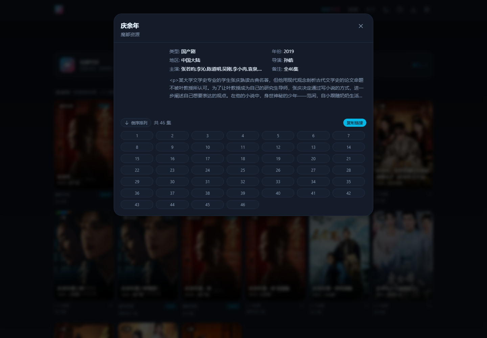
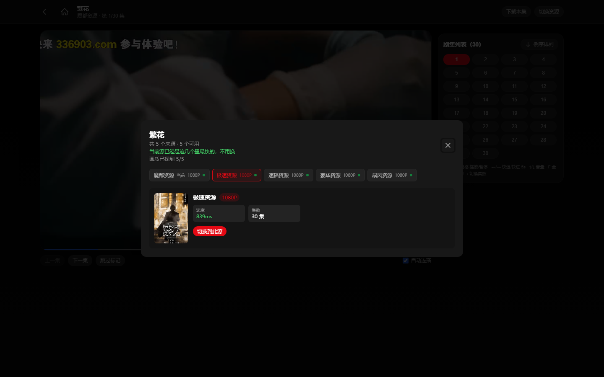

# lihongguotv-desktop

把开源的影视聚合站点 [LibreTV](https://github.com/LibreSpark/LibreTV) 做成**能在 Windows 上双击安装、在 macOS 上解压即用的桌面应用**，并接入了一个**短剧专区**（体裁分类 / 观看历史 / 换源续播）。

> **定位**：个人自建的播放器外壳，只负责「界面 + 播放 + 本机转发」。**不提供、不索引、不托管、不分发任何影视内容，不含任何片源、账号或订阅凭据**；所有可播放内容来自使用者自行配置的第三方接口。请勿用于商业用途或对外分发。
>
> 本项目是 [LibreTV](https://github.com/LibreSpark/LibreTV) 的桌面封装与二次开发分支，遵循上游 **AGPL-3.0** 许可；源码完整公开（AGPL 第 13 条）。合规边界与你的责任见 [docs/合规与免责.md](docs/合规与免责.md)。

---

## 目录

- [功能](#功能)
- [截图](#截图)
- [快速开始](#快速开始)
- [短剧专区](#短剧专区)
- [点播源与可用性排序](#点播源与可用性排序)
- [更新机制](#更新机制)
- [从源码运行](#从源码运行)
- [打包](#打包)
- [项目结构](#项目结构)
- [已知限制](#已知限制)
- [许可与致谢](#许可与致谢)

---

## 功能

**影视聚合（自建索引）**
- 多接口并行搜索（苹果CMS 协议），同名影片自动合并成一张卡片，可展开比较各来源
- 播放内核 ArtPlayer + hls.js，广告分片过滤、跳过片头片尾、倍速、快捷键
- 直播（M3U / IPTV），带分组、搜索、EPG 节目单
- 首页推荐：分类榜单 / 影视榜单（第三方公开评分数据）

**短剧专区（本项目新增）**
- **两层导航**：真人剧 / 漫剧 / AI短剧 → 各自的推荐 / 热播 / 新剧
- **观看历史**：按「剧 + 集」双维度记录进度，切回任意一集都接着上次的秒数
- **继续观看**：首页横排卡片，一键回到上次位置
- **换源续播**：同名剧换源后回到同一集，进度**只往前挪 10 秒**（不同源码率不同，往后挪必然漏剧情）
- **收藏 / 已看标记 / 连播倒计时 / 倍速记忆**
- 播放器快捷键（空格、←→、F、Esc），手机端双击暂停、左右滑动、长按 3 倍速
- 服务端历史同步：换浏览器、换设备登录同一站点，历史自动合并

**桌面体验**
- Windows：自带 Node 运行时与 ffmpeg，安装后双击即用，托盘常驻
- macOS：解压后双击 `.command` 启动
- 每天/按需检查更新：拉取短剧内核新版、按拉流速度重排可用点播源

---

## 截图

| 首页（豆瓣推荐） | 搜索结果（跨源合并） |
| --- | --- |
|  |  |

| 影片详情（跨源剧集列表） | 播放器 · 选集 |
| --- | --- |
|  |  |

> 短剧专区、续播与手机端播放器截图将在下次发布时更新：旧截图拍摄于 UI 更名之前，且画面含第三方影视内容，已从仓库移除。

---

## 快速开始

### Windows（推荐）

1. 打开 [Releases](../../releases) 下载 `lihongguotv-Setup-x.y.z.exe`
2. 安装（可选桌面快捷方式），双击 **lihongguotv**
3. 浏览器自动打开 `http://localhost:8080`，默认密码 **`lihongguotv`**
4. 退出：托盘图标右键 →「退出」

> 未做代码签名，首次运行 Windows 会提示「未知发布者」，点「更多信息 → 仍要运行」。

### macOS

1. 下载 `lihongguotv-macOS-arm64.zip`（Apple 芯片）或 `x64` 版本
2. 解压后双击 `启动lihongguotv.command`
3. 首次可能被 Gatekeeper 拦：右键 → 打开，或执行 `xattr -dr com.apple.quarantine ./lihongguotv-macOS`

### 改密码

编辑 `app/.env`（Windows 安装版在 `%LOCALAPPDATA%\Programs\lihongguotv\app\.env`）里的 `PASSWORD=`，重启应用。

---

## 短剧专区

入口：顶栏「短剧专区」，或首页的入口卡片。

**数据来源说明**

上游（字节系）的接口里，只有「漫剧」开放了官方榜单接口；真人剧与 AI 短剧的目录接口目前返回空。因此：

| 体裁 | 数据来源 |
| --- | --- |
| 漫剧 | 官方三榜（推荐 / 热播 / 新剧） |
| 真人剧 | 关键词聚合搜索 + 上游 `content_type=1` 精确过滤（真实拍摄） |
| AI短剧 | 上游 `content_type=1004` 且排除官方漫剧榜条目（合成画面） |

> `content_type` 这个字段是上游返回的体裁标识，最初的复刻项目把它丢弃了，本项目打补丁透传（见 `hongguo/PATCH.md`）。

**播放链路**

```
lihongguotv 页面 → /hg-api/* → 本机第三方内核 hongguo-web(127.0.0.1:8000)
                ↓
             内核自行完成取流与格式转换 → 以 mp4 形式回到播放器
```

- 同源转发：浏览器只跟 8080 打交道，不开额外端口、不撞 CORS
- 首播需 10–20 秒（取流 + 本地格式转换），之后同一集命中缓存秒开
- 缓存上限 120 集，自动淘汰最旧的

---

## 点播源与可用性排序

内置一批苹果CMS 协议的候选接口，另外每次体检会**在候选列表中重新探测并排序直连接口**：

```
内置候选池(24) + 当前配置 + 远程列表(qist/tvbox、gaotianliuyun/gao)
   ↓ 分批并发探活（关键词「庆余年」+ 校验标题真的命中，防止"假搜索站"）
   ↓ 已知快源优先（按实测拉流速度白名单）
   ↓ 只保留 6 个 → 写回 .env
```

**为什么是 6 个、为什么按拉流速度排**：搜索快 ≠ 播放快。实测中有的站搜索 600ms 但拉流只有 18KB/s，播起来必卡。白名单在 `tools/update.ps1` 的 `$FAST_HOSTS`。

手动体检：托盘菜单 →「检查更新（短剧内核 + 点播源）」；或命令行

```powershell
powershell -ExecutionPolicy Bypass -File tools\update.ps1 -Part sources
```

测自己的源速度：

```powershell
powershell -ExecutionPolicy Bypass -File tools\bench-sources.ps1
```

---

## 更新机制

`tools/update.ps1` 支持三种模式：

| 参数 | 作用 |
| --- | --- |
| `-Part kernel` | 拉取 [hongguo-web](https://github.com/sunnysky123/hongguo-web) 最新源码，备份旧内核（`src.bak-时间戳`），重新打 `content_type` 补丁，重启短剧服务 |
| `-Part sources` | 点播源体检 + 从公开列表补新源，写回 `.env` |
| `-Part all` | 两者都做（默认） |

- 下载走 4 个镜像（codeload / gh-proxy / ghfast / ghproxy.net）
- 源列表没实质变化时不写盘、不重启，避免打断观看
- 日志：`logs/update.log`

> ⚠️ 短剧内核由第三方独立维护，上游接口一旦调整就会失效，只能等对方更新。这是这条路线的固有风险。

---

## 从源码运行

需要 Node.js 20+ 与本机可用的 `ffmpeg`（短剧转码用）。

```bash
# 1) 主站
cd app
npm install
cp .env.example .env      # 填 PASSWORD
npm run build
npm start                 # http://localhost:8080

# 2) 短剧服务（另开一个终端）
git clone https://github.com/sunnysky123/hongguo-web hongguo-web
cd hongguo-web
# 打补丁：透传 content_type
powershell -ExecutionPolicy Bypass -File ../hongguo/patch-content-type.ps1 -Target ./server/src/service/client.js
PORT=8000 BIND_HOST=127.0.0.1 HG_TRANSCODE=1 node server/src/main.js
```

`app/next.config.ts` 里把 `/hg-api/*` 转发到 `http://127.0.0.1:8000`，可用环境变量 `HONGGUO_API` 覆盖。

---

## 打包

### Windows 安装包

```powershell
# 1) 组装便携目录（node/ffmpeg/app/hongguo/launcher）
powershell -ExecutionPolicy Bypass -File packaging\build-portable.ps1 -Out D:\Build\lihongguotv\stage

# 2) 编译启动器（需要 .NET Framework 的 csc）
csc /target:winexe /out:stage\lihongguotv.exe /win32icon:packaging\app.ico `
    /r:System.Windows.Forms.dll /r:System.Drawing.dll packaging\Launcher.cs

# 3) 用 Inno Setup 6 编译 packaging\lihongguotv.iss
ISCC.exe packaging\lihongguotv.iss
```

### macOS

发布物是**解压即用的便携目录**（不是 `.app`/`.dmg`：那需要 Apple 开发者签名与公证）。目录结构、运行时来源、`.command` 的换行符坑、压缩命令，都写在 [packaging/README.md](packaging/README.md) 的「macOS 便携包」一节。当前只出 Apple 芯片（arm64）版。

CI（[.github/workflows/build.yml](.github/workflows/build.yml)）只做 `next build` + `.ps1` 语法校验，**不出安装包** —— 安装包要内置 Node 运行时和 ffmpeg，体积上百 MB，放本地打更省事。

---

## 项目结构

```
.
├── app/                     Next.js 应用（lihongguotv 源码 + 短剧专区 + 桌面对接）
│   └── src/app/hongguo/     短剧专区页面
│   └── src/app/api/history/ 观看历史同步接口
├── packaging/               Windows 启动器(C#)、Inno Setup 脚本、便携目录组装脚本
├── tools/                   update.ps1（热更新）、bench-sources.ps1（源测速）
├── hongguo/                 上游内核补丁说明与补丁脚本
├── docs/                    架构、FAQ、截图
└── .github/workflows/       构建校验（next build + ps1 语法）
```

---

## 已知限制

1. **没有代码签名**：Windows SmartScreen 会提示未知发布者；macOS 需手动放行。
2. **短剧首播慢**：单集需取流 + 转封装 + 转码，约 10–20 秒；命中缓存后秒开。
3. **短剧依赖第三方内核**：接口或参数一变就失效，要等 hongguo-web 跟进。
4. **播放器未统一到 ArtPlayer**：短剧页用原生 `<video>`（保留画中画/全屏），短剧该有的倍速记忆、快捷键、手势已用原生方式补齐。
5. **只支持 x64（Windows）**，ARM64 Windows 未打包。

---

## 许可与致谢

- 本项目：**AGPL-3.0-or-later**（继承上游 LibreTV）
- [LibreSpark/LibreTV](https://github.com/LibreSpark/LibreTV)：影视聚合站点本体，AGPL-3.0
- [sunnysky123/hongguo-web](https://github.com/sunnysky123/hongguo-web)：短剧专区网页版内核，MIT
- [ArtPlayer](https://github.com/zhw2590582/ArtPlayer)（MIT）、[hls.js](https://github.com/video-dev/hls.js)（Apache-2.0）等：播放与转封装内核
- Node.js（MIT）、FFmpeg（LGPL/GPL，取决于构建）：随包运行时与转码

- 第三方组件全量清单：[NOTICE.md](NOTICE.md)
- 随包二进制的许可文本：[LICENSES/](LICENSES/)
- 合规与免责说明：[docs/合规与免责.md](docs/合规与免责.md)
- 版本变更：[CHANGELOG.md](CHANGELOG.md)

> **AGPL-3.0 第 13 条**：通过网络使用本软件的用户有权获取对应源码。本仓库即完整源码，未做任何删减。

---

## 免责声明

- 本项目仅供**个人学习与技术研究**使用，**不提供、不索引、不托管、不分发**任何影视内容，不含任何片源、账号或订阅凭据。
- 所有内容均来自使用者自行配置的第三方接口，与本项目作者无关；接口的合法性、可用性与内容版权由使用者自行判断与承担。
- 本项目与文中提及的任何第三方公司、平台或其商标**没有隶属、合作或授权关系**；相关名称与商标归其各自所有者，仅用于客观指代。
- 请勿用于商业用途、付费分发、大规模公开传播，或任何规避付费/授权的内容获取行为。
- 因使用本软件产生的一切后果由使用者自行承担；作者不对可用性、合法性或由此造成的损失作任何担保。

完整说明见 [docs/合规与免责.md](docs/合规与免责.md)。
